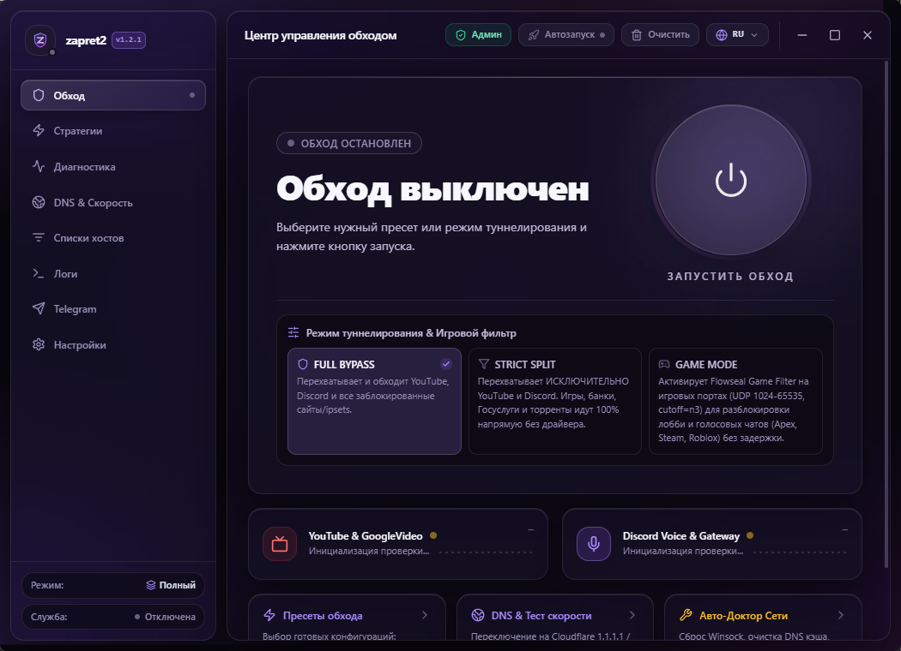

<p align="center">
  
</p>

# zapret2-gui

Программа для свободного интернета: без блокировок, замедлений и чужих решений, что вам можно смотреть и читать. YouTube, Discord и заблокированные сайты снова открываются, и весь интернет снова работает так, как должен. Без VPN и без серверов за границей: весь обход работает локально на вашем компьютере.

Появилась она из простой злости. Свободный интернет потихоньку превращался в набор разрешённых сайтов, а нормальных инструментов против этого не нашлось: одни выглядят как панель управления самолётом, другие умирают при первой же подкрутке блокировок, третьи требуют читать форумы, чтобы просто включить YouTube. Здесь вместо этого окно с одной кнопкой «Включить обход» и человеческими словами вместо технического жаргона. Если вы не знаете, что такое DPI, вам и не нужно: программа сделана так, чтобы разобраться мог любой.

Внутри движок [zapret2](https://github.com/bol-van/zapret2) от bol-van, который обманывает DPI, систему провайдера, которая рассматривает трафик и режет соединения с запрещёнными сайтами. Архив с программой весит 17 мегабайт, его не стыдно переслать другу прямо в мессенджере. На GitHub программу скачали под две тысячи раз.

[Скачать последнюю версию](https://github.com/mqclass/zapret2-gui/releases) · [English version](README_EN.md)

<p align="center">
  
</p>

> **Важно про фейки.** Программа распространяется только здесь, на GitHub. У проекта нет каналов в Telegram, страниц на YouTube и зеркал на файлообменниках. Если zapret2-gui предлагают скачать в другом месте, это не мы, внутри может быть что угодно.

## Что умеет

Почти всё из этого списка уже есть в текущей версии. Две вещи пока живут в тестовых сборках и приедут в ближайшем обновлении: разделение по приложениям и режимы обхода для Lua-стратегий.

- **Включение в один клик.** Кнопка «Включить обход» и мастер «Что хотите разблокировать?»: YouTube, Discord или всё сразу. Дальше программа сама подбирает, как именно обходить вашего провайдера.
- **Сама чинится, когда провайдер подкрутил блокировки.** Знакомый сценарий: вчера всё открывалось, сегодня YouTube мёртв. Автоподбор переберёт готовые стратегии (их больше десятка) и оставит ту, что работает прямо сейчас. Отдельный сторож следит за обходом в фоне и запускает тот же подбор при деградации, без вашего участия.
- **Три режима обхода.** Полный: обход для всего. Строгий: только YouTube и Discord, а игры, банки, Госуслуги и торренты идут напрямую, как будто обхода нет. Игровой: полный плюс порты игр и голосовых чатов, чтобы работали лобби и войс. Режимы действуют на стратегии Flowseal и Lua-пресеты; на флагманскую стратегию и свои конфиги не распространяются.
- **Разделение по приложениям.** Через обход можно пустить только выбранные программы, например Discord и браузер, а остальное оставить напрямую. Или наоборот: всё через обход, кроме выбранных.
- **Telegram без VPN.** Встроенный мост для Telegram на случай, когда мессенджер не открывается через обычный обход.
- **Свой DNS в один клик.** Cloudflare, Google, Quad9 и другие вместо провайдерского, плюс раздельный режим: для заблокированных доменов один DNS, для остальных другой. Там же замер скорости YouTube прямо в программе, чтобы было видно, что обход не душит видео.
- **Диагностика одной кнопкой.** «Доктор» проверяет сеть, находит конфликты с другими обходами (GoodbyeDPI и подобные), прибирает зависшие процессы и сбрасывает запомненные системой адреса сайтов (кэш DNS).
- **Не умирает вместе с окном.** При закрытии программа сворачивается в трей, а обход держит отдельная фоновая служба. Закроете окно через диспетчер задач, обход продолжит работать. Остановите службу, и после неё не останется зависших драйверов и сломанного интернета: зависшие драйверы и мёртвая сеть после выключения это вечная болезнь подобных программ, здесь служба прибирает за собой.
- **Автозапуск вместе с Windows.** Настроил один раз и забыл: при входе в систему обход включается сам, без лишних окон и подтверждений.
- **Свои сайты и конфиги.** Нужный вам сайт не открывается? Добавьте его домен в список прямо из окна. Чужие конфиги импортируются из .bat-файлов, есть [руководство по конфигам](CONFIG_GUIDE.md).
- **Интерфейс на трёх языках:** русский, английский, украинский.

## Как пользоваться

Нужны Windows 10 или 11, 64 бита.

1. Скачайте архив `zapret2-v<версия>-windows-x64.zip` со [страницы релизов](https://github.com/mqclass/zapret2-gui/releases) и распакуйте в любую папку.
2. Запустите `zapret2.exe`. Программа попросит права администратора: они нужны драйверу, который заворачивает трафик в обход.
3. Нажмите «Включить обход» и ответьте, что хотите разблокировать. Всё.

Если какой-то сайт не открылся и после этого, добавьте его домен на вкладке сайтов или запустите автоподбор на вкладке стратегий.

## Что за что отвечает

- `zapret2.exe` — окно программы: настройки, стратегии, диагностика.
- `zapret2-svc.exe` — фоновая служба. Держит обход включённым, когда окно закрыто, и следит, чтобы после выключения сеть осталась чистой.
- `winws2.exe` / `winws.exe` — движок обхода от bol-van. Это он обрабатывает трафик.
- Стратегии и списки доменов — готовые рецепты обхода: пресеты Flowseal и Lua-пресеты zapret2, плюс списки, какие сайты пускать через обход.
- `WinDivert` — драйвер перехвата трафика. Поэтому программе нужны права администратора.

## Сборка из исходников

Нужны Node.js 18+, Rust stable и Tauri CLI v2.

```powershell
git clone https://github.com/mqclass/zapret2-gui.git
cd zapret2-gui
npm install
powershell -ExecutionPolicy Bypass -File scripts/setup_binaries.ps1
npm run build
cd src-tauri
cargo build --release
```

Готовый файл: `src-tauri/target/release/zapret2-supervisor.exe`.

## Откуда берутся бинарники

В репозитории скомпилированных файлов нет, это проверяемо. При сборке скрипт `setup_binaries.ps1` скачивает движок и данные из официальных релизов [zapret2](https://github.com/bol-van/zapret2/releases) (v1.0.6) и [zapret-discord-youtube](https://github.com/Flowseal/zapret-discord-youtube/releases) (1.10.4), а контрольная сумма SHA256 каждого архива заранее записана в скрипте: не совпала с эталоном, сборка останавливается. Движок разделения по приложениям `winws2-split.exe` собирается из [нашего форка zapret2](https://github.com/mqclass/zapret2), его адрес и контрольная сумма записаны там же.

## Linux

Linux-версия уже написана и живёт в ветке dev: тот же интерфейс и служба, движок nfqws2, захват трафика через nftables. Служба и движок проверены автоматическими тестами и живым запуском на сервере сборок, а вот на домашнем компьютере с обычным рабочим столом версию пока никто не обкатывал. Поэтому релизов для Linux нет и появятся они только после такой обкатки.

## Спасибо

- [bol-van](https://github.com/bol-van/zapret2) — движок zapret2 и сам метод обхода DPI.
- [Flowseal](https://github.com/Flowseal/zapret-discord-youtube) — стратегии и списки доменов.
- [medvedeff-true](https://github.com/medvedeff-true/Zapret-Gui) — идеи интерфейса.

## Лицензия

MIT, см. [LICENSE](LICENSE).
