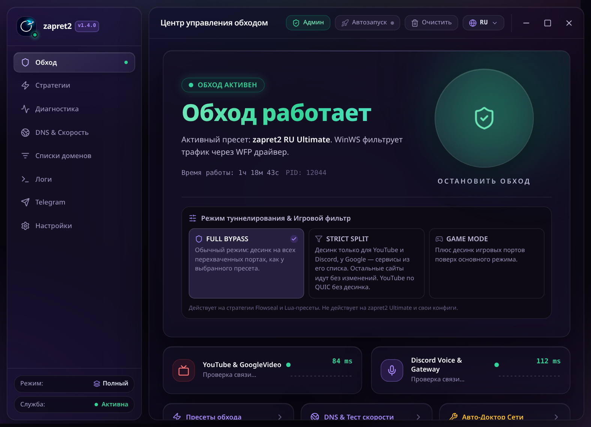

<p align="center">
  
</p>

# zapret2-gui

<p align="center">
  <a href="https://github.com/MixasV/zapret2-gui/releases/latest"></a>
  <a href="https://github.com/MixasV/zapret2-gui/releases"></a>
  <a href="https://github.com/MixasV/zapret2-gui/stargazers"></a>
</p>

> **This is a fork.** The original project lives at [mqclass/zapret2-gui](https://github.com/mqclass/zapret2-gui): that is where the main development, the releases and the official Telegram channel [«Незапретка»](https://t.me/zapret2_gui) are. This repository is the same program plus reliability fixes that the original does not have yet: an exit that actually stops everything, a service the window can always connect to, a Telegram bridge that stands back up on its own. All the differences, in order, are in ["What this fork changes compared to the original"](#what-this-fork-changes-compared-to-the-original).

A program for a free internet: no blocks, no throttling, and nobody else deciding what you may watch or read. YouTube, Discord and blocked sites open again, and the whole internet works the way it should. No VPN and no servers abroad: the bypass runs entirely on your own computer.

It exists out of plain frustration. The free internet was quietly turning into a list of approved sites, and there were no decent tools against that: some look like an airplane cockpit, others die the moment the provider tightens the blocks, and the rest make you dig through forums just to turn on YouTube. Here, instead, you get a window with a single "Enable bypass" button and human words instead of technical jargon. If you don't know what DPI is, you don't need to: the program is built so that anyone can figure it out.

Under the hood is the [zapret2](https://github.com/bol-van/zapret2) engine by bol-van, which fools DPI, the provider's system that inspects traffic and cuts connections to banned sites. The program archive weighs 17 megabytes, small enough to forward to a friend right in a messenger.

[Download the latest version](https://github.com/MixasV/zapret2-gui/releases) · [Русский](README.md)

<p align="center">
  
</p>

> **A word about fakes.** Neither the original project nor this fork is distributed anywhere but GitHub: the original lives at [mqclass](https://github.com/mqclass/zapret2-gui), this fork at [MixasV](https://github.com/MixasV/zapret2-gui), and news of the original is published in the Telegram channel [«Незапретка»](https://t.me/zapret2_gui). The project has no YouTube pages and no mirrors on file-sharing sites. If zapret2-gui is offered to you anywhere else, that is not us, and anything could be inside.

## What this fork changes compared to the original

The original project belongs to [mqclass](https://github.com/mqclass/zapret2-gui), and the main development happens there. This fork is the same program plus reliability fixes that the original does not have yet.

- **An exit that actually stops everything.** "Quit" in the tray used to stop only what ran inside the program window, while the background service and the engine went on filtering traffic with no window behind them — the process had to be finished off by hand in Task Manager. Now "Quit" stops the whole chain: first the service gets four seconds for a graceful shutdown; if it does not make it, it is stopped forcibly — together with the engine it keeps an eye on — and the traffic interception driver is unloaded after that. The window's X button still just folds the program into the tray, and the bypass keeps running: only an explicit "Quit" stops everything.
- **A service the window can always connect to.** Two causes of the window hanging forever on connecting to the background service are fixed: the service's communication channel was created in a mode its networking library cannot use, and starting the service failed when the system refused to break a new process out of the window's process group. Both cases are handled now, and the service starts and answers the way it should.
- **A Telegram bridge that stands back up on its own.** When Telegram's relays are unreachable and the messenger's server addresses are hard-blocked, the bridge used to re-walk every relay with full timeouts on each new connection and flood the engine with attempts to reach dead addresses — and never crawled out of that storm by itself. Now every unreachable relay and every dead address gets a breather for a while: they are skipped without attempts during it, and the ones that come back to life are picked up again automatically, without restarting the program.
- **A quiet engine and a clean auto-list.** The bypass engine no longer logs every packet it processes: the log does not bloat, the service does not choke on the output stream under load, and a verbosity level explicitly set in your own configs is still respected. And bare IP addresses no longer end up in the auto domain list: because of them, the engine used to "bypass" traffic to completely unrelated servers where a connection just happened to fail.
- **Honest documentation of the design.** [docs/ARCHITECTURE.md](docs/ARCHITECTURE.md) has been rewritten to match how the program is actually built: the window and the service as two separate binaries, LOCAL and REMOTE modes, communication over a named pipe, handing the engine over to the service's care, the guaranteed teardown on exit, and the bridge's circuit breaker.

The current release, v1.4.0, was built before these fixes and behaves the old way; the next release will ship with them.

## Features

Everything on this list is already in the current version.

- **One-click start.** The "Enable bypass" button and a wizard that asks "What do you want to unblock?": YouTube, Discord, or everything at once. From there the program works out on its own how to get around your provider.
- **It repairs itself when the provider tightens the blocks.** A familiar story: yesterday everything opened, today YouTube is dead. Auto-tuning runs through the ready-made strategies (there are more than a dozen) and keeps the one that works right now. A separate watchdog keeps an eye on the bypass in the background and runs the same tuning when quality degrades, without you lifting a finger.
- **Three bypass modes.** Full: bypass for everything. Strict: only YouTube and Discord, while games, banks, government services and torrents go direct, as if there were no bypass at all. Gaming: full plus the ports of games and voice chats, so lobbies and voice work. The modes apply to Flowseal strategies and Lua presets; they do not extend to the flagship strategy or to custom configs.
- **Per-app split tunneling.** You can send only selected programs through the bypass, say Discord and a browser, and leave everything else direct. Or the other way round: everything through the bypass except the selected ones.
- **Telegram without a VPN.** A built-in bridge for Telegram, for the cases when the messenger won't open through the regular bypass.
- **Your own DNS in one click.** Cloudflare, Google, Quad9 and others instead of the provider's, plus a split mode: one DNS for blocked domains, another for the rest. The same screen has a YouTube speed test right in the program, so you can see that the bypass is not throttling your video.
- **Diagnostics in one button.** The "Doctor" checks the network, finds conflicts with other bypass tools (GoodbyeDPI and the like), tidies up stuck processes and resets the site addresses the system has memorized (the DNS cache).
- **It doesn't die with the window.** When you close it, the program folds into the tray, and a separate background service keeps the bypass running. Close the window through Task Manager and the bypass carries on. Stop the service, and it leaves no stuck drivers and no broken internet behind: stuck drivers and a dead network after shutdown are the eternal disease of tools like this, here the service cleans up after itself.
- **Starts together with Windows.** Set it up once and forget it: when you sign in, the bypass turns itself on, with no extra windows or confirmations.
- **Your own sites and configs.** A site you need still won't open? Add its domain to the list right from the window. Other people's configs are imported from .bat files, and there is a [config guide](CONFIG_GUIDE.md).
- **Interface in three languages:** Russian, English, Ukrainian.

## How to use it

You need Windows 10 or 11, 64-bit.

1. Download the `zapret2-v<version>-windows-x64.zip` archive from the [releases page of this repository](https://github.com/MixasV/zapret2-gui/releases) and unpack it into any folder.
2. Run `zapret2.exe`. The program will ask for administrator rights: they are needed by the driver that wraps traffic into the bypass.
3. Press "Enable bypass" and answer what you want to unblock. That's all.

If some site still doesn't open after that, add its domain on the sites tab or run auto-tuning on the strategies tab.

## What is responsible for what

- `zapret2.exe` is the program window: settings, strategies, diagnostics.
- `zapret2-svc.exe` is the background service. It keeps the bypass on while the window is closed and makes sure the network stays clean after shutdown.
- `winws2.exe` / `winws.exe` are the bypass engine by bol-van. It is the one that processes the traffic.
- Strategies and domain lists are the ready-made bypass recipes: Flowseal presets and zapret2 Lua presets, plus the lists of which sites to send through the bypass.
- `WinDivert` is the traffic interception driver. That is why the program needs administrator rights.

## Building from source

You need Node.js 18+, stable Rust and Tauri CLI v2.

```powershell
git clone https://github.com/MixasV/zapret2-gui.git
cd zapret2-gui
npm install
powershell -ExecutionPolicy Bypass -File scripts/setup_binaries.ps1
npm run build
cd src-tauri
cargo build --release
```

The finished file: `src-tauri/target/release/zapret2-supervisor.exe`.

## Where the binaries come from

There are no compiled files in the repository, and that is verifiable. During the build, the `setup_binaries.ps1` script downloads the engine and the data from the official releases of [zapret2](https://github.com/bol-van/zapret2/releases) (v1.0.7) and [zapret-discord-youtube](https://github.com/Flowseal/zapret-discord-youtube/releases) (1.10.4), and the SHA256 checksum of every archive is written into the script in advance: if a checksum does not match the reference, the build stops. The per-app split engine `winws2-split.exe` is built from [the zapret2 fork maintained by the original project's author](https://github.com/mqclass/zapret2); its address and checksum are recorded in the same place.

## Linux

The Linux version is already written and lives in the dev branch: the same interface and service, the nfqws2 engine, traffic capture through nftables. The service and the engine are checked by automated tests and a live run on the build server, but on a home computer with an ordinary desktop nobody has put this version through its paces yet. That is why there are no Linux releases, and they will appear only after such a shakedown.

## Found a bug?

The program is made by one person — the original author — and one person cannot test it on every provider and every computer, so bug reports genuinely help. Where to write depends on what broke: if it is one of this fork's fixes or a build from this repository, [open an issue here](https://github.com/MixasV/zapret2-gui/issues/new/choose); if it is a general bug in the program, take it to the [original project's issues](https://github.com/mqclass/zapret2-gui/issues/new/choose) instead — the main development lives there, and a fix made there will land here too. The most useful things to include are the program version, your internet provider, and the check result for the site that does not open — it is collected on the Diagnostics tab.

## Thanks

- [mqclass](https://github.com/mqclass/zapret2-gui) for the original zapret2-gui project: the interface, the service, the auto-tuning and all the day-to-day work; this fork only adds fixes on top of it.
- [bol-van](https://github.com/bol-van/zapret2) for the zapret2 engine and the DPI bypass method itself.
- [Flowseal](https://github.com/Flowseal/zapret-discord-youtube) for the strategies and domain lists.
- [medvedeff-true](https://github.com/medvedeff-true/Zapret-Gui) for interface ideas.

## License

MIT, see [LICENSE](LICENSE).
